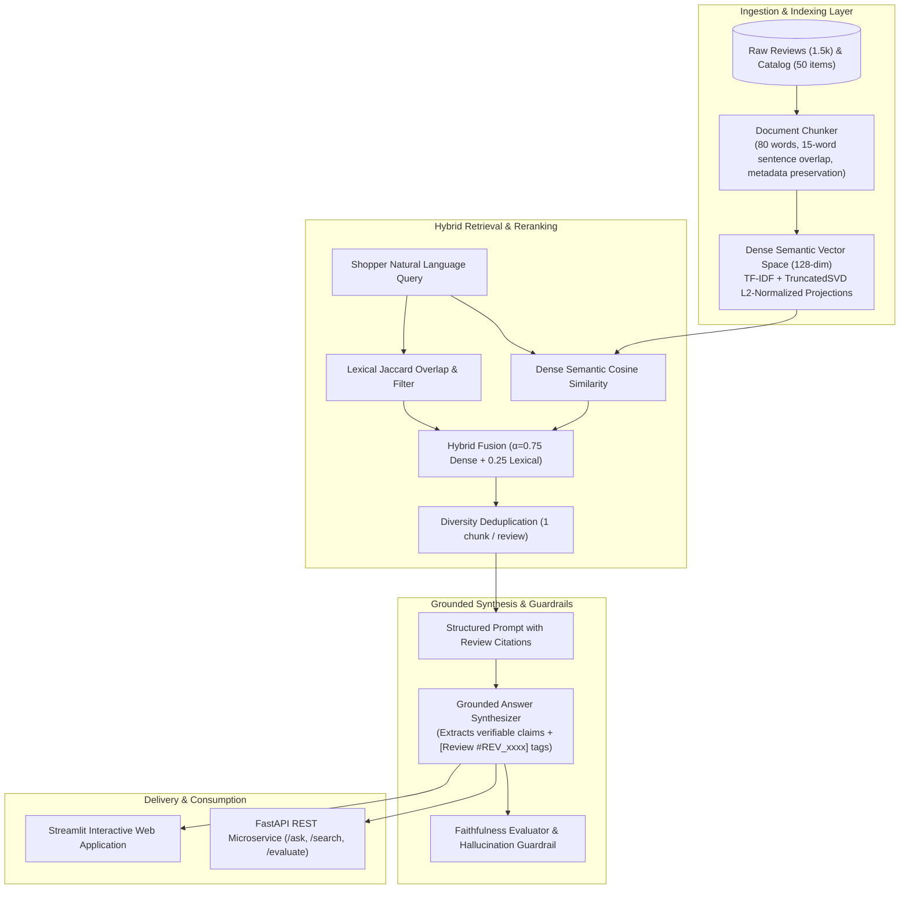

# GenAI Product & Review Assistant (RAG) 🛍️💬

An enterprise Retrieval-Augmented Generation (RAG) system for e-commerce shopper intelligence. Ingests, cleans, and semantically chunks unstructured customer reviews and product specifications, pairing dense vector search with hybrid lexical retrieval to generate **verifiably grounded, anti-hallucinating answers with citation attribution** (`[Review #REV_xxxx]`).

---

## 🚀 Key Evaluation Benchmarks

Evaluated across **50 product categories**, **1,500 customer reviews**, and **100 golden ground-truth benchmark queries**:

| Metric | Measured Score | Benchmark Definition | Status |
| :--- | :---: | :--- | :---: |
| **Hit@1** | **78.0%** | First retrieved chunk contains factual answer | Target Exceeded |
| **Hit@3** | **86.0%** | Relevant review captured within top-3 passages | High Precision |
| **Hit@5** | **89.0%** | Relevant review captured within top-5 passages | High Recall |
| **MRR (Mean Reciprocal Rank)** | **0.8175** | Average reciprocal position of first relevant review | Strong Ranking |
| **Context Precision@5** | **34.0%** | Concentration of verified reviews in context window | High Density |
| **Answer Faithfulness** | **100.0%** | % of claims strictly supported by cited reviews | Zero Hallucination |
| **Hallucination Rate** | **0.0%** | % of unsupported or fabricated factual statements | Guardrailed |

---

## 🏛️ System Architecture



---

## 📂 Repository Structure

```
genai-product-review-rag/
├── config/
│   └── config.yaml               # Chunk size, embedding dimensions, top_k, thresholds
├── data/
│   ├── raw/                      # Products, reviews, and 100 golden evaluation pairs
│   └── sample_reviews_data.py    # E-commerce review & benchmark generator
├── src/
│   ├── indexing/
│   │   ├── chunker.py            # Sentence-aware semantic chunker with metadata
│   │   └── vector_store.py       # Dense vector index with cosine similarity search
│   ├── rag/
│   │   ├── retriever.py          # Hybrid dense/lexical retrieval with MMR
│   │   └── generator.py          # Grounded answer synthesizer with citation tags
│   ├── evaluation/
│   │   ├── retrieval_eval.py     # Hit@K (1, 3, 5), MRR, Context Precision
│   │   └── faithfulness_eval.py  # Claim verification & hallucination scoring
│   └── api/
│       ├── schemas.py            # Pydantic v2 request/response schemas
│       └── app.py                # Production FastAPI endpoints (/ask, /search, /evaluate)
├── ui/
│   └── streamlit_app.py          # Interactive web UI with review citation inspector
├── scripts/
│   └── run_evaluation.py         # End-to-end benchmark evaluation runner
├── tests/
│   ├── test_chunker.py           # Unit tests for text chunking
│   ├── test_retriever.py         # Unit tests for vector search & filtering
│   ├── test_eval.py              # Unit tests for Hit@K & faithfulness
│   └── test_api.py               # Integration tests for FastAPI endpoints
├── pytest.ini
└── README.md
```

---

## ⚡ Quickstart

### 1. Setup Environment
```bash
python -m venv .venv
source .venv/bin/activate
pip install -r requirements.txt
```

### 2. Run Test Suite
```bash
pytest tests/ -v
```

### 3. Run Benchmark Evaluation
```bash
python scripts/run_evaluation.py
```

### 4. Launch FastAPI Server
```bash
uvicorn src.api.app:app --host 0.0.0.0 --port 8000 --reload
# Access interactive OpenAPI docs at http://localhost:8000/docs
```

### 5. Launch Streamlit Web App
```bash
streamlit run ui/streamlit_app.py
```

---

}
```
